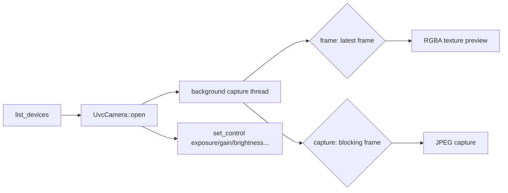

<p align="center">
  
</p>

<div align="center">
  <h1 align="center">uvc-camera · Cross-platform UVC Camera Engine</h1>
  <p><strong>Driver-free · Windows MediaFoundation / Linux V4L2 / macOS AVFoundation</strong></p>
  <p>
    <a href="LICENSE">📄 Apache-2.0</a> |
    <a href="https://docs.rs/uvc-camera">📚 Docs</a> |
    <a href="https://crates.io/crates/uvc-camera">📦 crates.io</a> |
    <a href="https://gitee.com/eternalnight996/uvc-camera">🌟 Gitee</a>
  </p>
  <p><a href="README.md">简体中文</a> | English</p>
</div>

---

> A driver-free UVC camera engine for Rust (built on nokhwa), with API design modeled after the
> AndroidUSBCamera high-level `CameraClient`: enumerate devices → open (resolution/fps) →
> background preview stream → single-frame capture → UVC controls (exposure/gain/brightness…).
> Suited for production-line photo archiving, vision capture, and conferencing.

## ✨ Features

- 📷 **Driver-free**: Windows MediaFoundation / Linux V4L2 / macOS AVFoundation — plug & play for any UVC device
- 🔍 **Device enumeration**: list all UVC cameras (name/index), mirroring AndroidUSBCamera's `USBMonitor` + multi-camera picker
- 🎥 **Background preview stream**: a capture thread runs on open (nokhwa `CallbackCamera`); `frame()` reads the latest frame non-blocking
- 📸 **Single-frame capture**: `capture()` grabs the latest frame and encodes JPEG, mirroring `JPG capture`
- 🎛 **UVC controls**: exposure / gain / brightness / contrast / saturation / sharpness / focus / white balance, mirroring `getSupportedControls` / `setCtrlValue`
- 🪟 **Resolution switching**: `set_resolution()` with Closest strategy, switch capture size at runtime
- 🐧 **Cross-platform**: Windows / Linux (Kylin V10 / UOS V20 / Ubuntu 18.04+) / macOS, unified API

## 🔄 Workflow



## 🚀 Quick Start

### Add dependency

```toml
[dependencies]
uvc-camera = "0.1"
```

### Minimal example (enumerate → open → frame → capture)

```rust
use uvc_camera::{list_devices, OpenOptions, UvcCamera};

fn main() -> uvc_camera::Result<()> {
    let devs = list_devices()?;
    println!("found {} UVC camera(s)", devs.len());
    for d in &devs {
        println!("  [{}] {}", d.index, d.name);
    }
    let Some(dev) = devs.first() else { return Ok(()) };
    let mut cam = UvcCamera::open(dev.index, OpenOptions::default())?;
    println!("resolution: {:?}", cam.resolution());
    let frame = cam.frame()?;          // latest frame (RGBA preview)
    println!("preview frame: {}x{} ({} bytes)", frame.width, frame.height, frame.data.len());
    let jpeg = cam.capture(85)?;       // blocking frame → JPEG
    println!("captured: {} bytes", jpeg.len());
    cam.close()?;
    Ok(())
}
```

Real build output (Windows MSVC):

```bash
$ cargo build
   Compiling uvc-camera v0.1.0 (F:\MyApp\eternal\uvc-camera)
    Finished `dev` profile [unoptimized + debuginfo] target(s) in 1.47s

$ cargo test
test tests::rgba_decode_shape ... ok
test device::tests::open_options_with_resolution_sets_width_height ... ok
test result: ok. 7 passed; 0 failed
```

> ⚠️ Running the example requires a USB camera connected (`list_devices` skips capture if empty).

## 🖥️ Platform Support

| Backend | Windows 10/11 | Ubuntu 18.04+ | Kylin V10 / UOS | macOS | Status |
|---|---|---|---|---|---|
| MediaFoundation (default) | ✅ | — | — | — | driver-free |
| V4L2 (default) | — | ✅ | ✅ | — | driver-free |
| AVFoundation (default) | — | — | — | ✅ | driver-free |
| UVC controls (exposure/gain…) | ✅ | ✅ | ✅ | ✅ | device-dependent |

## 📚 API Overview

| Module | API | Description |
|---|---|---|
| `device` | `list_devices()` / `DeviceInfo` / `OpenOptions` | enumeration & open preferences |
| camera | `UvcCamera::open()` / `frame()` / `capture()` / `close()` | open, preview frame, JPEG capture, close |
| camera | `set_resolution()` / `format()` | resolution switching & current format |
| `control` | `supported_controls()` / `set_control()` / `get_control()` | UVC controls (`Control` / `ControlValue` / `ControlInfo`) |

## 💡 Why Choose

- **Pain point**: industrial UVC cameras have diverse SDKs and troublesome drivers → **driver-free plug & play**, one API for all UVC devices
- **Pain point**: mature UVC engines exist on Android (AndroidUSBCamera/UVCCamera) but not on desktop → **ported that engine design to Rust desktop**
- **Pain point**: preview blocks the UI thread → **background capture thread**, non-blocking `frame()`
- **Ecosystem**: built on nokhwa (Apache-2.0, actively maintained); this crate is a thin, auditable wrapper

## 🛠 Development / Contributing

- Build via `justfile` (Windows needs VS2022 Build Tools/MSVC; Linux cross-compile needs cargo-zigbuild + zig, glibc 2.27 baseline)
- `just setup` → `just build-win` / `just build-linux` → `just dist` (dual-platform zip)
- `just test` unit tests (no hardware needed; real-device verification via the example above)
- Before PR: code conforms to standards, core logic tested, docs in sync
- Welcome contributions: more UVC controls, multi-camera parallel, YUV direct output, etc.

## 📄 License

[Apache-2.0](LICENSE)

<div align="center">
  <sub>If uvc-camera helps you, feel free to ⭐ Star or submit a PR!</sub>
</div>

<div align="center"><sub>Built with ❤️ by HEG Technology</sub></div>
