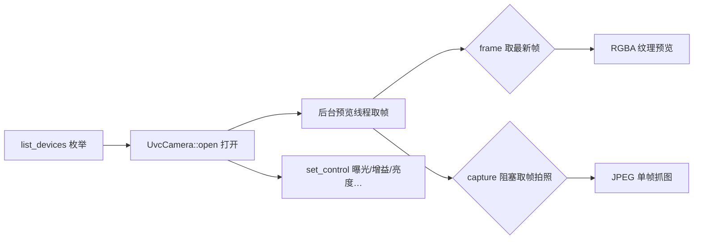

<p align="center">
  
</p>

<div align="center">
  <h1 align="center">uvc-camera · 跨平台 UVC 相机统一引擎</h1>
  <p><strong>免驱即插即用 · Windows MediaFoundation / Linux V4L2 / macOS AVFoundation</strong></p>
  <p>
    <a href="LICENSE">📄 Apache-2.0</a> |
    <a href="https://docs.rs/uvc-camera">📚 Docs</a> |
    <a href="https://crates.io/crates/uvc-camera">📦 crates.io</a> |
    <a href="https://gitee.com/eternalnight996/uvc-camera">🌟 Gitee</a>
  </p>
  <p>简体中文 | <a href="README.en.md">English</a></p>
</div>

---

> Rust 的 USB 免驱 UVC 相机统一引擎（基于 nokhwa），API 设计参考 AndroidUSBCamera 高层引擎 `CameraClient`：
> 设备枚举 → 打开（分辨率/帧率）→ 后台预览流 → 单帧抓图 → UVC 控制（曝光/增益/亮度…）。
> 适合产线拍照留档、视觉采集、视频会议等场景。

## ✨ Features

- 📷 **免驱即插即用**：Windows MediaFoundation / Linux V4L2 / macOS AVFoundation，UVC 设备插入即用，无需厂商驱动
- 🔍 **设备枚举**：列出全部 UVC 相机（名称/序号），对齐 AndroidUSBCamera 的 `USBMonitor` + 多相机选择
- 🎥 **后台预览流**：打开即启动后台取帧线程（nokhwa `CallbackCamera`），`frame()` 非阻塞取最新帧
- 📸 **单帧抓图**：`capture()` 阻塞取最新一帧并编码 JPEG，对齐 `JPG 拍照`
- 🎛 **UVC 控制**：曝光 / 增益 / 亮度 / 对比度 / 饱和度 / 清晰度 / 对焦 / 白平衡，对齐 `getSupportedControls` / `setCtrlValue`
- 🪟 **分辨率切换**：`set_resolution()` Closest 策略，运行中切换采集尺寸
- 🐧 **跨平台**：Windows / Linux（Kylin V10 / UOS V20 / Ubuntu 18.04+）/ macOS，统一 API

## 🔄 工作流程



## 🚀 Quick Start

### 添加依赖

```toml
[dependencies]
uvc-camera = "0.1"
```

### 最小示例（枚举 → 打开 → 取帧 → 抓图）

```rust
use uvc_camera::{list_devices, OpenOptions, UvcCamera};

fn main() -> uvc_camera::Result<()> {
    let devs = list_devices()?;
    println!("发现 {} 台 UVC 相机", devs.len());
    for d in &devs {
        println!("  [{}] {}", d.index, d.name);
    }
    let Some(dev) = devs.first() else { return Ok(()) };
    let mut cam = UvcCamera::open(dev.index, OpenOptions::default())?;
    println!("分辨率: {:?}", cam.resolution());
    let frame = cam.frame()?;          // 最新帧（RGBA 预览）
    println!("预览帧: {}x{} ({} bytes)", frame.width, frame.height, frame.data.len());
    let jpeg = cam.capture(85)?;       // 阻塞取一帧 → JPEG
    println!("抓图: {} bytes", jpeg.len());
    cam.close()?;
    Ok(())
}
```

真实构建输出（本机 Windows MSVC）：

```bash
$ cargo build
   Compiling uvc-camera v0.1.0 (F:\MyApp\eternal\uvc-camera)
    Finished `dev` profile [unoptimized + debuginfo] target(s) in 1.47s

$ cargo test
test tests::rgba_decode_shape ... ok
test device::tests::open_options_with_resolution_sets_width_height ... ok
test result: ok. 7 passed; 0 failed
```

> ⚠️ 运行示例需连接 USB 相机（`list_devices` 返回空则跳过拍照）。

## 🖥️ 平台支持

| 后端 | Windows 10/11 | Ubuntu 18.04+ | 麒麟 V10 / 统信 UOS | macOS | 状态 |
|---|---|---|---|---|---|
| MediaFoundation（默认） | ✅ | — | — | — | 免驱 |
| V4L2（默认） | — | ✅ | ✅ | — | 免驱 |
| AVFoundation（默认） | — | — | — | ✅ | 免驱 |
| UVC 控制（曝光/增益等） | ✅ | ✅ | ✅ | ✅ | 依赖设备支持 |

## 📚 API 概览

| 模块 | API | 说明 |
|---|---|---|
| `device` | `list_devices()` / `DeviceInfo` / `OpenOptions` | 设备枚举与打开偏好 |
| 相机 | `UvcCamera::open()` / `frame()` / `capture()` / `close()` | 打开、预览帧、JPEG 抓图、关闭 |
| 相机 | `set_resolution()` / `format()` | 分辨率切换与当前格式 |
| `control` | `supported_controls()` / `set_control()` / `get_control()` | UVC 控制项（`Control` / `ControlValue` / `ControlInfo`） |

## 💡 Why Choose

- **痛点**：工业 UVC 相机各家 SDK 各异、驱动安装麻烦 → **免驱即插即用**，一套 API 兼容所有 UVC 设备
- **痛点**：Android 平台有成熟的 UVC 引擎（AndroidUSBCamera/UVCCamera），桌面没有 → **移植其引擎设计到 Rust 桌面**
- **痛点**：预览阻塞 UI → **后台线程取帧**，`frame()` 非阻塞读最新帧
- **生态**：底层 nokhwa（Apache-2.0，活跃维护），本 crate 薄封装、可审计

## 🛠 Development / Contributing

- 构建统一走 `justfile`（Windows 需 VS2022 Build Tools/MSVC；Linux 交叉编译需 cargo-zigbuild + zig，glibc 2.27 基线）
- `just setup` 装依赖 → `just build-win` / `just build-linux` → `just dist`（双平台 zip）
- `just test` 单元测试（无需真机；真机验证用上方示例）
- 提交 PR 前：代码符合规范、核心逻辑有测试、文档同步
- 欢迎贡献：更多 UVC 控制项、多相机并行、YUV 直接输出等

## 📄 License

[Apache-2.0](LICENSE)

<div align="center">
  <sub>如果 uvc-camera 对你有帮助，欢迎 ⭐ Star 支持，或提交 PR 一起完善～</sub>
</div>

<div align="center"><sub>Built with ❤️ by HEG Technology</sub></div>
